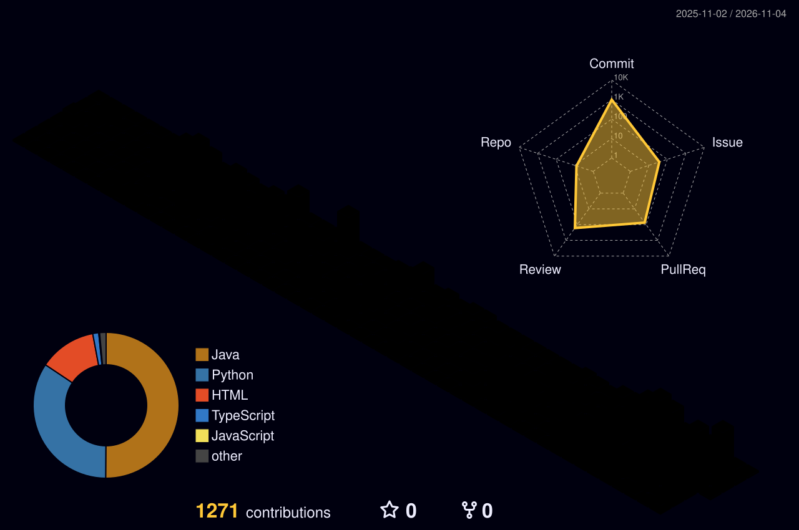

  

  문제를 스스로 찾아내 해결해 나가는 과정을 좋아하는 백엔드 개발자입니다. 
  로그와 지표에서 이상한 점을 발견하고, 원인을 좁혀 가며 고치는 순간을 가장 좋아합니다.

 

## Tech Stack

**Backend**

  
  
  
  
  

**Database**

  
  
  

**Infra & DevOps**

  
  
  
  

**Monitoring & Test**

  
  
  
  

**Collaboration**

  
  
  

 

## Contributions

